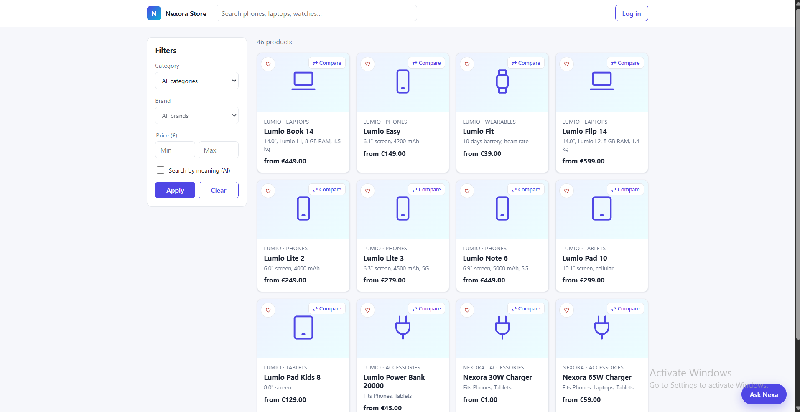
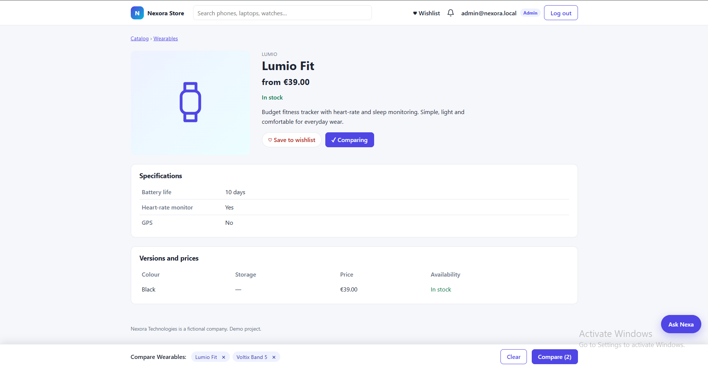
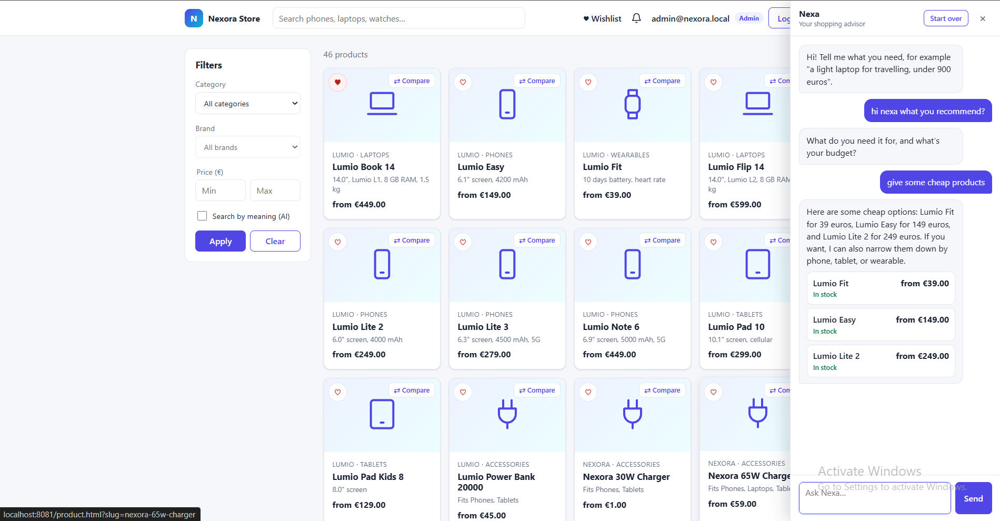
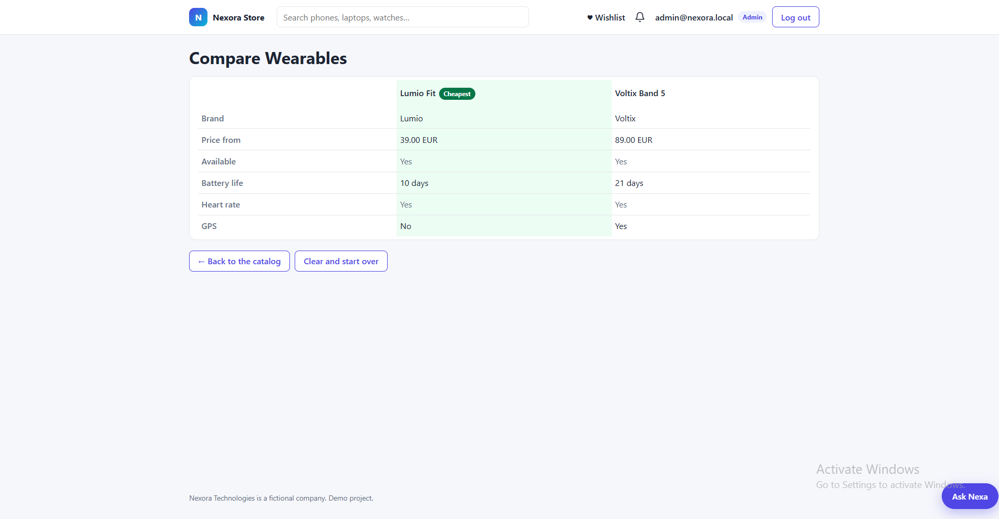
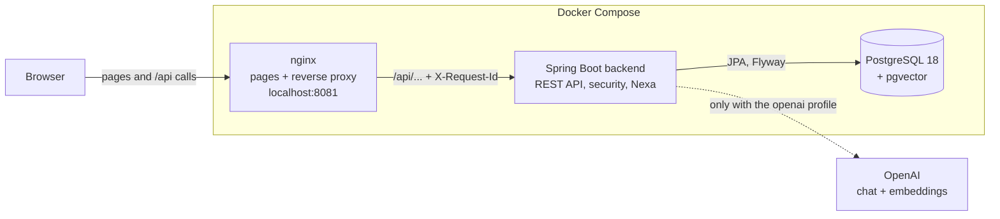
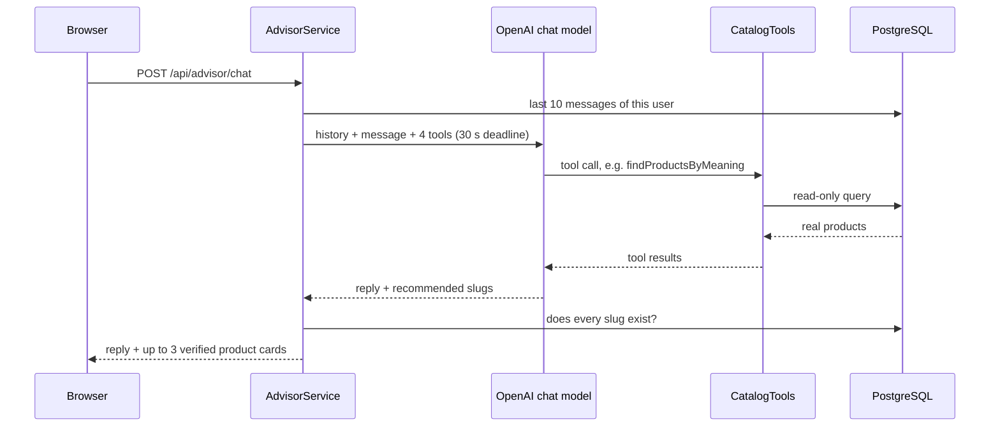
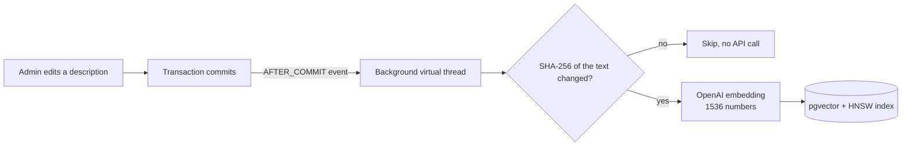

# Nexora Store


An online electronics store for Nexora Technologies, a fictional company that sells phones, laptops,
tablets, wearables and accessories. It comes with **Nexa**, an AI shopping advisor that recommends only
real products from the catalog, with live prices and stock.

Built step by step with Java 25, Spring Boot 4, PostgreSQL 18 (pgvector) and Docker.

## Screenshots

| Catalog | Product page |
|---|---|
|  |  |
| **Nexa, the AI advisor** | **Compare** |
|  |  |

## Features

**Store**
- Catalog with filters (category, brand, price, text), pagination and product pages with variants
- Accounts: register, log in (JWT), roles USER and ADMIN
- Reviews with average rating, wishlist, price-drop notifications (scheduled job)
- Compare 2 to 4 products of the same category side by side
- Admin: change prices and stock safely (optimistic locking, price history), edit descriptions

**Nexa, the AI advisor**
- Chat with tool calling: Nexa searches the catalog through read-only tools, never invents products
- Every recommended product is checked against the database before it is shown as a card
- Conversation memory per user, "start over" to forget it, a timeout with a friendly message
- Search by meaning: product descriptions as embeddings in pgvector, hybrid with category and price filters
- Measured with a golden set of 20 realistic questions (OpenAI text-embedding-3-small: hit@1 0.95, hit@3 1.0)

**Engineering**
- Automated tests in every phase (JUnit, AssertJ, Mockito, Testcontainers with a real PostgreSQL)
- GitHub Actions CI on every push, branch protection with pull requests
- Docker Compose stack: PostgreSQL, Spring Boot backend, nginx serving the front end and proxying the API
- Observability: a request id in every log line (nginx and backend), metrics, health checks
- Test coverage measured with JaCoCo, shown in every CI run summary
- Docker images published to GitHub Container Registry on every version tag

## Tech stack

| Area | Tools |
|---|---|
| Language and framework | Java 25, Spring Boot 4.1, Spring Security (JWT resource server), Spring AI |
| Data | PostgreSQL 18 with pgvector, Spring Data JPA / Hibernate, Flyway migrations |
| AI | OpenAI chat model with tool calling and structured output, OpenAI embeddings |
| Front end | Plain HTML, CSS and JavaScript (ES modules), served by nginx |
| Quality | JUnit, Mockito, Testcontainers, GitHub Actions |
| Operations | Docker, Docker Compose, Spring Boot Actuator, Micrometer |

## How it fits together

## How Nexa works (AI design)

The main rule: **the AI may talk, but only the database decides what is real.**



| Decision | Why |
|---|---|
| Nexa sees the catalog only through 4 read-only tools (`searchProducts`, `findProductsByMeaning`, `getProductDetails`, `compareProducts`) | It can look things up but can never change data |
| Structured output: a reply plus a list of product slugs | Product cards are built from the database, not from the model's text |
| Every slug is checked; unknown ones are dropped and logged | AI output is treated as untrusted input, so an invented product never reaches the page |
| 30-second deadline on a virtual thread | The customer gets a friendly message instead of a hanging page |
| Memory of the last 10 messages per user, with "start over" | Context for follow-up questions, with a fixed cost per call |
| The front end shows replies with `textContent` | Model text can never inject HTML or scripts |
| Offline clients by default; the AI is off in tests and CI | No costs, and tests give the same result every time |

### Search by meaning

Each product description is turned into an embedding (1536 numbers, OpenAI text-embedding-3-small)
and stored in PostgreSQL with pgvector and an HNSW index. A question is embedded the same way, and the
closest products win. Category and price filters are plain SQL in the same query (hybrid search).



**Measured, not guessed.** A golden set of 20 realistic customer questions, each with the product a
person would pick, runs through `POST /api/admin/embeddings/evaluate`:

| Metric | Meaning | Result |
|---|---|---|
| hit@1 | the right product is first | 0.95 |
| hit@3 | the right product is in the top 3 | 1.0 |
| MRR | average of 1 / position of the right product | 0.975 |

## Run the whole stack with Docker

1. Copy `.env.example` to `.env` and set `DB_PASSWORD`, `JWT_SECRET` (32+ random characters) and the admin account.
2. Start everything:
   ```
   docker compose up -d --build
   ```
3. Open the store at http://localhost:8081 and the API docs at http://localhost:8081/swagger-ui.html

The backend reports healthy after about 20 seconds (`docker compose ps`); nginx starts after it.

Nexa runs **offline** by default (a fixed reply, no costs). For the real advisor and search by meaning,
set these in `.env` and run `docker compose up -d` again:
```
NEXORA_PROFILES=docker,openai
OPENAI_API_KEY=your key
OPENAI_MODEL=the chat model you chose in the OpenAI dashboard
```

Stop with `docker compose down` (data is kept). `docker compose down -v` also deletes the database.

## Develop in IntelliJ

1. Start only the database: `docker compose up -d db`
2. Run `NexoraStoreApplication` with the `dev` profile (it also activates `openai`).
3. The API runs at http://localhost:8080 (Swagger UI: http://localhost:8080/swagger-ui.html).

Front-end changes: edit the files in `web/`, then `docker compose up -d --build web` and refresh
http://localhost:8081.

## Tests

```
./mvnw verify
```
Docker must be running: the tests start their own PostgreSQL with Testcontainers and never touch your
development database. The AI is offline in tests and in CI.

## Debugging tips

- Every response has an `X-Request-Id` header. Search for it in both logs to follow one request:
  ```
  docker compose logs web | findstr THE_ID
  docker compose logs backend | findstr THE_ID
  ```
  (use `grep` instead of `findstr` on Linux and macOS)
- Health: http://localhost:8081/actuator/health
- Metrics (admin token needed): `/actuator/metrics/nexa.chat`, `/actuator/metrics/cache.gets`

## Project layout

```
src/main/java/com/practice/nexora/
  catalog/        products, brands, variants,